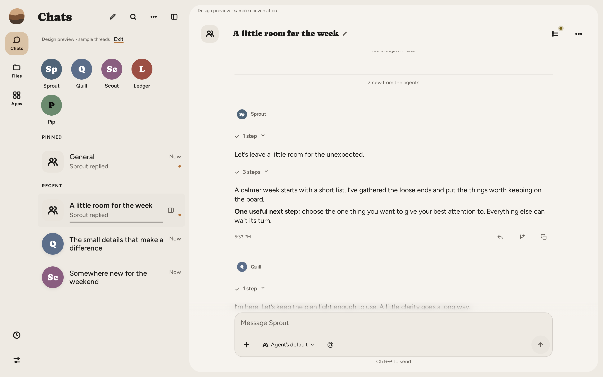
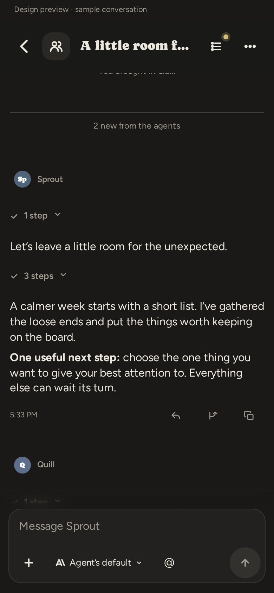

# Loam

**A home for your own AI agents, on your own server.**

Each agent has a soul, a workspace and a memory, all made of plain files you
can read and edit. You talk with them in threads in a web app, on your
laptop or your phone. They share a vault of Markdown notes with you, keep
boards of what is worth your attention, run on schedules you approve, and
can brief an engineer agent to change code, Loam's own included.

Loam is a small core and plugins. The core is the runtime, the web app and
the files. Everything else, from read-aloud to comments on documents, is a
plugin you can turn on or off, or write yourself.

<p align="center">
  
  &nbsp;
  
</p>

<sub>Screenshots from the app's design preview, with sample agents and threads.</sub>

## Install

On a fresh server, as root:

```sh
curl -fsSL https://raw.githubusercontent.com/loamhq/loam/main/install.sh | sudo bash -s -- --name <name>
```

It takes a few minutes, can be run again at any time, and ends with a
one-time link that makes you the owner. It installs the newest release.

**What you need:**

- **A server** running Debian 12 or Ubuntu 24.04, with a public IPv4 address,
  at least 4 GB of memory and 15 GB of free disk.
- **A name on the web.** Your Loam lives at `<name>` under Loam's own
  domain (`BASE_DOMAIN` in `lib/loam_install.py`). The installer prints the
  two DNS records it needs (`<name>` and `*.<name>`, type A, pointing at your
  server); records under that domain are added by whoever runs it, today
  Loam's maintainers. Loam waits for them and goes on the web by itself once
  they resolve.
- **An account with an AI provider**: Claude (Claude Code), ChatGPT (Codex)
  or Google (Antigravity). You sign in from the app; Loam signs in to nothing
  on your behalf.

The eleven steps, and what each one leaves on the server, are in
[docs/install.md](docs/install.md). Updating is `loam update`
([docs/update.md](docs/update.md)).

## Learn more

- [What changed in each release](CHANGELOG.md)
- [Configuration](docs/config.md): one file, `/etc/loam/loam.toml`, says
  where everything of an install is
- [Plugins](docs/plugins.md): how to add something without changing Loam
- [The web app](app/README.md) and [the edge](deploy/README.md) (sign-in,
  TLS, the agents' browser)
- [Iris](docs/starter.md), the agent every install starts with

## Working on it

The runtime's tests are `python3 tests/run-all`; the app's are `npm test` in
`app/`. [CONTRIBUTING.md](CONTRIBUTING.md) says how a change reaches `main`,
and [SECURITY.md](SECURITY.md) how to report a vulnerability.

| Folder | What |
|---|---|
| `install.sh`, `bin/loam-install` | the one command and its steps |
| `bin/`, `lib/` | the runtime: wakes, the session broker, the engineer, the generators, `loam status` and `loam update` |
| `app/` | the web app: Node's standard library, no dependencies |
| `mcp/`, `hooks/` | the agents' MCP servers and Claude Code hooks |
| `deploy/`, `systemd/` | the edge (Caddy, Authelia, the sign-in page) and the unit templates |
| `plugins/` | first-party plugins: the reviewer, daily notes, comments & suggestions |
| `docs/` | how each part works and why; `docs/library/` becomes every install's `System/Loam/` |
| `engineer/memory/` | what building Loam has taught |

Loam is in version 0.x: the shape of the files and the interfaces may still
change between releases, and each release's notes say what moved.

## License

Loam is free software under the GNU Affero General Public License, version 3
only (AGPL-3.0-only). If you run a modified Loam for other people over a
network, you offer them its source. The full text is in [LICENSE](LICENSE).
